# Antes de começar...

lista de presença!

{.absolute bottom="10" right="50" width="240" height="240"}

# Antes de começar (2)...

::: nonincremental
- Dúvidas gerais sobre a aula anterior?

- Exercício dos dias anteriores: dúvidas, comentários, considerações?

{.absolute bottom="-150" right="0" width="200" height="200"}
:::

## Estrutura da aula {.theme-next}

:::::: columns
::: {.column width="30%"}
Tópicos que vamos cobrir hoje são:
:::

:::: {.column width="70%"}
::: {style="text-align: left;"}
- Tipos de Medida na PNADC

- Análise prática a partir de um caso recente

- Tópicos complementares

- Próximos passos
:::
::::
::::::

# Retomada de aspectos da aula 2 {.theme-first}

::: {style="text-align: left;"}
Pacotes para uso da PNADC em R e suas respectivas funções
:::

## [Pacotes e funções]{.theme-subtopic} {.smaller}

Na aula 2, mencionei sobre os dois pacotes que, em geral, utilizamos. Abaixo estão as funções:

:::::: nonincremental
::::: columns
::: {.column width="50%"}
`{PNADcIBGE}`: uso para importação e tratamento inicial dos dados.

- `get_pnadc()`: download e importação **online** dos dados.

- `read_pnadc()`: importação **offline** dos dados.

- `pnadc_design()`: atribuição do plano amostral complexo automaticamente.

- `pnadc_labeller()`: atribuição dos rótulos a cada variável.

- `pnadc_deflator()`: atribuição das variáveis com deflatores, caso importação offline.
:::

::: {.column width="50%"}
`{survey}`: uso para análises descritivas da base com plano amostral aplicado.

- `svytotal()`: somatório de valores absolutos.

- `svymean()`: média de variáveis contínuas e proporções para categóricas.

- `svyratio()`: razões entre variáveis.

- `svyvar()`: variância para variáveis contínuas.

- `svyquantile()`: quantis e seus intervalos de confiança.
:::
:::::
::::::

## [Outros aspectos importantes da PNADC: peso]{.theme-subtopic} {.smaller}

Variáveis de peso amostral

- **V1032**: originalmente, a variável V1032 é aquela que contém o peso com ajustes pós-coleta e com calibração pela projeção populacional.

- Outros pesos contidos na base: (i) V1031 não contém calibração pela projeção; (ii) V1032\[001\]-V1032\[200\] contêm os pesos reamostrados.

- Em geral, não utilizamos esta(s) variáveis de peso pois o pacote da PNADC já contém a forma de lidar com ela. Exceto: (i) quando aplicamos o peso manualmente; (ii) para estimativas pontuais.

## [Outros aspectos importantes da PNADC: deflatores]{.theme-subtopic}

::: nonincremental
Deflatores

- Usamos os deflatores para corrigir/ajustar os valores de rendimentos obtidos em determinado período do tempo (nominais) para valores que sejam comparáveis com um outro momento no tempo (reais).

- Incorporado à PNADc (via pacote PNADcIBGE), **temos os deflatores do IPCA**[^1].
:::

[^1]: Índice Nacional de Preços ao Consumidor Amplo.

## [Outros aspectos importantes da PNADC]{.theme-subtopic}

::: nonincremental
Como usamos no R?

- **Para rendimento habitual**: usar os argumentos `get_pnadc(...,deflator=TRUE, defyear = ANO, defperiod = TRIMESTRE)`. Depois multiplicar a variável de interesse: $VAR\_INTERESSE \cdot Habitual$.

- **Para rendimento efetivo**: usar os argumentos `get_pnadc(...,deflator=TRUE, defyear = ANO, defperiod = TRIMESTRE)`. Depois multiplicar a variável de interesse: $VAR\_INTERESSE \cdot Efetivo$
:::

# Tipos de Medida na PNADC {.theme-first}

::: {style="text-align: left;"}
Análise de dados, pesquisa e R
:::

## [Análise de dados e pesquisa]{.theme-subtopic} {.smaller}

::::: columns
::: {.column width="20%"}
Fluxo de análise de dados[^2] que, geralmente, seguimos:
:::

::: {.column width="80%"}
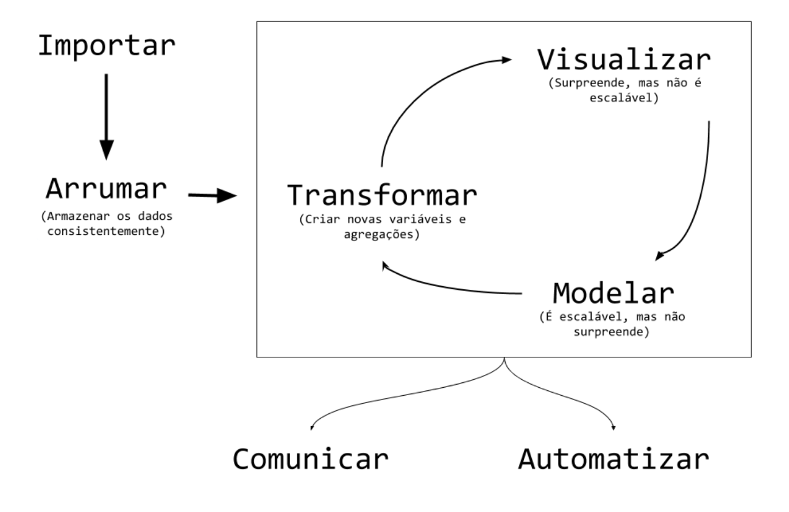{fig-align="center" width="100%" height="100%"}
:::
:::::

[^2]: Fonte: Curso-R. Ciência de dados em R. Ver referências da aula.

## [Natureza das variáveis]{.theme-subtopic} {.smaller}

São categorizações excludentes, *todavia, uma variável pode ser transformada em outra natureza/tipo*.

::::: columns
::: {.column width="50%"}
### Qualitativa {style="text-align: center;"}

Valores apresentam atributos ou qualidades.

- **Nominal** (não ordenado) - pode ainda ser dividida em binária ou não.

  - Ex.: estados, sexo, nomes.

- **Ordinal** (ordenado)

  - Ex.: nível de escolaridade, [faixa de renda]{.fragment .highlight-red}, faixa de tamanho de cidade
:::

::: {.column width="50%"}
### Quantitativa {style="text-align: center;"}

Valores são expressos em números, apresentam quantidades.

- **Discreta** (contagem) - expressa em números inteiros.

  - Ex.: anos de estudos, número de irmãos, número de domicílios.

- **Contínua** (medidas) - expressa em números infinitesimais.

  - Ex.: Altura, peso, [renda]{.fragment .highlight-red}
:::
:::::

## [Natureza das variáveis em R]{.theme-subtopic} {.smaller}

:::::: nonincremental
**Como verificar:** no R, podemos verificar o seu tipo/natureza usando funções, como “class()” ou “str()”.

::::: columns
::: {.column width="50%"}
### Qualitativa {style="text-align: center;"}

Valores apresentam atributos ou qualidades.

- **Nominal** (não ordenado) - pode ainda ser dividida em binária ou não.

  - R: character / factor.

- **Ordinal** (ordenado)

  - R: factor
:::

::: {.column width="50%"}
### Quantitativa {style="text-align: center;"}

Valores são expressos em números, apresentam quantidades.

- **Discreta** (contagem) - expressa em números inteiros.

  - R: Integer.

- **Contínua** (medidas) - expressa em números infinitesimais.

  - R: double
:::
:::::
::::::

## [Tipos de medidas]{.theme-subtopic} {.smaller}

Para cada tipo de variável, há um tipo de medida que se adequa melhor à sua análise.

- **Números absolutos**

- **Números relativos** (distribuição relativa; composição)

- **Proporção** (numerador está contido no denominador)

- **Taxa** (numerador **não** está contido no denominador)

- **Razão** (divisão de duas grandezas quaisquer)

- **Medidas de tendência central** (média, moda, mediana)

- **Medidas de variabilidade/dispersão** (variância, desvio padrão, coeficiente de variação)

## [Tipos de medidas no R usando Plano Amostral]{.theme-subtopic} {.font-size-small}

::: nonincremental
`Em destaque abaixo`, há uma forma de implementação de cada medida em R.

- **Números absolutos** = `svytotal(~VARIAVEL, design = BASE_COM_PLANO_AMOSTRAL)`

- **Números relativos** (distribuição relativa; composição) = `svymean(~VARIAVEL, design = BASE_COM_PLANO_AMOSTRAL)`

- **Proporção** (numerador está contido no denominador) = `svymean(~VARIAVEL, design = BASE_COM_PLANO_AMOSTRAL)`

- **Taxa** (numerador **não** está contido no denominador) = `svyratio(~NUMERADOR, ~DENOMINADOR, design = BASE_COM_PLANO_AMOSTRAL)`

- **Razão** (divisão de duas grandezas quaisquer) = `svyratio(~NUMERADOR, ~DENOMINADOR, design = BASE_COM_PLANO_AMOSTRAL)`

- **Medidas de tendência central** (média, moda, mediana) = `svymean(~NUMERADOR, ~DENOMINADOR, design = BASE_COM_PLANO_AMOSTRAL)`, `svyquantile(~VARIAVEL, quantiles=~c(.5), design = BASE_COM_PLANO_AMOSTRAL)`

- **Medidas de variabilidade/dispersão** (variância, desvio padrão, coeficiente de variação) = `confint(tabela)`, `cv(tabela)`, `SE(tabela)`
:::

## Tipos de análises {.theme-subtopic .smaller}

Há níveis de análises que são necessários de serem explorados na interação de fenômenos/variáveis.

:::::: columns
::: {.column width="30%"}
### Univariada {style="text-align: center;"}

Variável qualitativa (binária, ordinal)

Variável quantitativa (contínua, discreta)
:::

::: {.column width="30%"}
### Bivariada {style="text-align: center;"}

Quali X Quanti

Quali X Quali

Quanti X Quanti
:::

::: {.column width="30%"}
### Multivariada {style="text-align: center;"}

Quali X Quali X Quali

Quali X Quali X Quanti

Quanti X Quanti X Quali

Quanti X Quanti X Quati
:::
::::::

## Tipos de análises {.theme-subtopic .smaller}

Há níveis de análises que são necessários de serem explorados na interação de fenômenos/variáveis[^3].

[^3]: Ver capítulo 10 do Livro "PNADC na prática", na ementa do curso.

:::::: columns
::: {.column width="30%"}
### Univariada {style="text-align: center;"}

```{r, echo=FALSE}
data("iris")
library(pacman)
p_load(ggplot2,dplyr)

# plot
iris |> 
  ggplot() +
  aes(x = Sepal.Width) +
  geom_density(linewidth = 1.5) +
  labs(x="",y="") +
  theme_minimal()
```

```{r, echo=FALSE}
data("iris")
library(pacman)
p_load(ggplot2,dplyr)

# plot
iris |> 
  filter(Sepal.Width >= 3.2) |> 
  mutate(value = 1) |>
  summarise(n = sum(value), .by = Species) |> 
  ggplot() +
  aes(x = Species, y = n) +
  geom_col() +
  labs(x="",y="") +
  theme_minimal() +
  theme(axis.text = element_blank())
```
:::

::: {.column width="30%"}
### Bivariada {style="text-align: center;"}

```{r, echo=FALSE}
data("iris")
library(pacman)
p_load(ggplot2,dplyr)

# plot
iris |> 
  ggplot() +
  aes(x = Sepal.Width, y = Sepal.Length) +
  geom_point(size = 3) +
  labs(x="",y="") +
  theme_minimal()
```

```{r, echo=FALSE}
data("iris")
library(pacman)
p_load(ggplot2,dplyr)

# plot
iris |> 
  filter(Sepal.Width >= 3.2) |> 
  mutate(value = 1, grande = ifelse(Sepal.Width >= 3.300, "Sim", "Não")) |>
  summarise(n = sum(value), .by = c(Species, grande)) |> 
  ggplot() +
  aes(x = Species, y = n, fill = grande) +
  geom_col(show.legend = FALSE) +
  coord_flip() +
  labs(x="",y="") +
  scale_fill_viridis_d() +
  theme_minimal() +
  theme(axis.text = element_blank())
```
:::

::: {.column width="30%"}
### Multivariada {style="text-align: center;"}

```{r, echo=FALSE}
data("iris")
library(pacman)
p_load(ggplot2,dplyr)

# plot
iris |> 
  ggplot() +
  aes(x = Sepal.Width, y = Sepal.Length, color = Species) +
  geom_point(size = 3, show.legend = FALSE) +
  labs(x="",y="") +
  scale_color_viridis_d() +
  theme_minimal()
```
:::
::::::

# Análise prática a partir de um caso recente {.theme-first}

::: {style="text-align: left;"}
Imposto de renda zero!
:::

## [O caso]{.theme-subtopic} {.smaller}

A ideia da [Lei 15.270, sancionada em 2025](https://www12.senado.leg.br/noticias/materias/2025/11/27/sancionada-isencao-do-imposto-de-renda-para-quem-ganha-ate-r-5-mil-por-mes) é de ser um passo a mais na garantia de uma maior justiça redistributiva no Brasil.

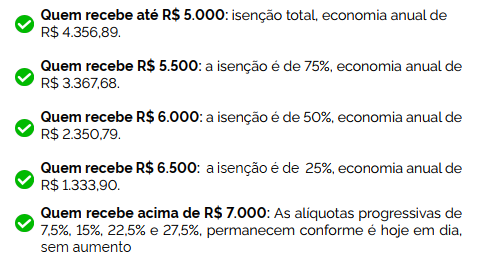{fig-align="center" width="100%" height="100%"}

## [O caso]{.theme-subtopic} {.font-size-small}

A ideia da [Lei 15.270, sancionada em 2025](https://www12.senado.leg.br/noticias/materias/2025/11/27/sancionada-isencao-do-imposto-de-renda-para-quem-ganha-ate-r-5-mil-por-mes) é de ser um passo a mais na garantia de uma maior justiça redistributiva no Brasil.

:::::: columns
:::: {.column width="70%"}
::: nonincremental
### Problemática

Qual seria a parcela dos trabalhadores de um específico estado que *potencialmente* seriam beneficiados com imposto zero?

### Tarefas para responder à problemática

1.  Número de pessoas ocupadas no Brasil.

2.  Número de pessoas Ocupadas com potencialmente beneficiados.

3.  Proporção de pessoas ocupadas potencialmente beneficiados entre os ocupados.

4.  Renda média do grupo dos potencialmente beneficiados ou não.

5.  Proporção de potencialmente beneficiados por UF.
:::
::::

::: {.column width="30%"}
{fig-align="center" width="120%" height="120%"}
:::
::::::

## [O caso]{.theme-subtopic} {.font-size-small}

A ideia da [Lei 15.270, sancionada em 2025](https://www12.senado.leg.br/noticias/materias/2025/11/27/sancionada-isencao-do-imposto-de-renda-para-quem-ganha-ate-r-5-mil-por-mes) é de ser um passo a mais na garantia de uma maior justiça redistributiva no Brasil.

:::::: columns
:::: {.column width="70%"}
::: nonincremental
### Problemática

Qual seria a parcela dos **trabalhadores** de um específico **estado** que *potencialmente* seriam **beneficiados com imposto zero**?

### Tarefas para responder à problemática

1.  Número de pessoas ocupadas no Brasil.

2.  Número de pessoas Ocupadas com potencialmente beneficiados.

3.  Proporção de pessoas ocupadas potencialmente beneficiados entre os ocupados.

4.  Renda média do grupo dos potencialmente beneficiados ou não.

5.  Proporção de potencialmente beneficiados por UF.
:::
::::

::: {.column width="30%"}
{fig-align="center" width="120%" height="120%"}
:::
::::::

## [O caso na PNADC]{.theme-subtopic}

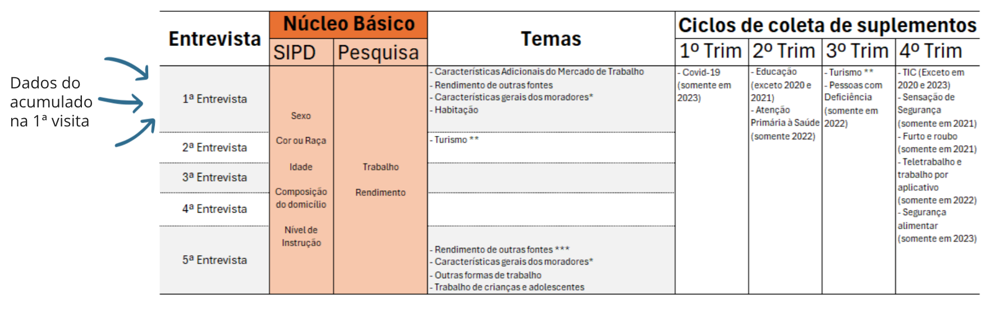{fig-align="center" width="120%" height="120%"}

## [O caso na PNADC]{.theme-subtopic}

{fig-align="center" width="120%" height="120%"}

{.absolute bottom="0" right="0" width="200" height="200"}

Por que **Visita 1** e não a **Visita 5** ou trimestre?

##  {.smaller}

### Criação de variáveis

:::::: columns
:::: {.column width="50%"}
::: nonincremental
Estado/UF

- Variável da PNADC (`UF`)

População Ocupada

- Baseado na condição de ocupação (`VD4002`)

Potencialmente beneficiados

- Com base na renda mensal do trabalho principal (`VD4017`)

  - Beneficiário: renda menor ou igual a R\$ 5.000,00

  - Não beneficiário: acima de R\$ 5.000,00
:::
::::

::: {.column width="50%"}
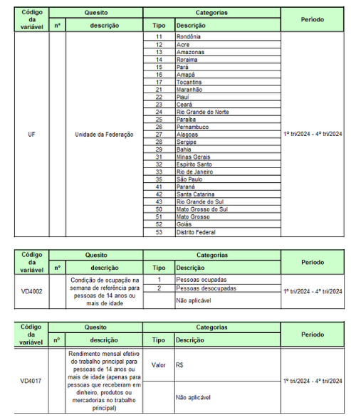{fig-align="center" width="120%" height="120%"}
:::
::::::

# (Parêntesis) {.theme-first}

::: {style="text-align: left;"}
Distintas formas de importação dos dados
:::

## [Formas de importação dos dados]{.theme-subtopic} {.smaller}

::: nonincremental
```{r,eval=FALSE}
 Pnad_2022_2s <- get_pnadc(
           
   year = 2022,# obrigatório de ser declarado 
   quarter/interview/topic = , # 
   design = TRUE, # opcional, utilizado caso queira aplicar o plano amostral complexo aos dados
   vars = c("codigo_variavel1","codigo_variavel2", "codigo_variavelN"), # opcional
   labels = TRUE, # é o default, para rotular os dados
   deflator = TRUE # é o default, para incluir variável de deflacionamento direto do IBGE
)
```

O que vai, basicamente variar é o argumento `quarter/interview/topic`.

- Devemos escolher um deles, a depender do nosso interesse de análise.

- Acumulado na entrevista: `interview`;

- Acumulado no trimestre: `quarter`

- Suplemento acumulado no trimestre: `topic`

Lembrem-se que **esses argumentos (quarter/interview/topic) são excludentes** no pacote. Ou seja, deve-se escolher um deles.
:::

## [Formas de importação dos dados]{.theme-subtopic} {.smaller}

::::: columns
::: {.column width="70%"}
**1. Importação de dados trimestrais:**

```{r,eval=FALSE}
 Pnad_2022_2s <- get_pnadc(
           
   year = 2022,# obrigatório de ser declarado 
   quarter = 2, # utilizado somente quando importaremos dados em determinado trimestre
   design = TRUE, # opcional, utilizado caso queira aplicar o plano amostral complexo aos dados
   vars = c("codigo_variavel1","codigo_variavel2", "codigo_variavelN"), # opcional
   labels = TRUE, # é o default, para rotular os dados
   deflator = TRUE # é o default, para incluir variável de deflacionamento direto do IBGE
)
```
:::

::: {.column width="30%"}
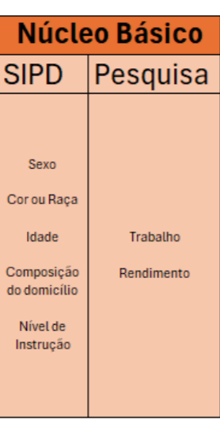{fig-align="center" width="60%" height="60%"}
:::
:::::

## [Formas de importação dos dados]{.theme-subtopic} {.smaller}

::::: columns
::: {.column width="70%"}
**2. Importação dos dados ACUMULADOS em determinada visita:**

```{r,eval=FALSE}
Pnad_2022_2s <- get_pnadc(
  year = 2022, # obrigatório de ser declarado
  interview = 1, # utilizado somente quando importaremos dados em determinada visita
  design = TRUE, # opcional, utilizado caso queira aplicar o plano amostral complexo aos dados
  vars = c("codigo_variavel1","codigo_variavel2", "codigo_variavelN"), # opcional
  labels = TRUE, # é o default, para rotular os dados
  deflator = TRUE # é o default, para incluir variável de deflacionamento direto do IBGE
)
```
:::

::: {.column width="30%"}
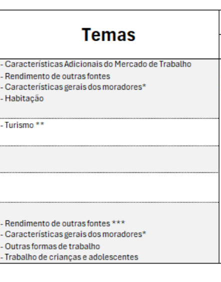{fig-align="center" width="100%" height="100%"}
:::
:::::

## [Formas de importação dos dados]{.theme-subtopic} {.smaller}

::::: columns
::: {.column width="70%"}
**3. Importação de SUPLEMENTO de dados ACUMULADOS em determinado trimestre:**

Variáveis iniciadas com $V$ ou $VI$: ver sempre o dicionário

```{r,eval=FALSE}
Pnad_2022_2s <- get_pnadc(
  year = 2022, # obrigatório de ser declarado
  topic = 4, # utilizado somente quando importaremos dados em determinado trimestre
  design = TRUE, # opcional, utilizado caso queira aplicar o plano amostral complexo aos dados
  vars = c("codigo_variavel1","codigo_variavel2", "codigo_variavelN"), # opcional
  labels = TRUE, # é o default, para rotular os dados
  deflator = TRUE # é o default, para incluir variável de deflacionamento direto do IBGE
)
```
:::

::: {.column width="30%"}
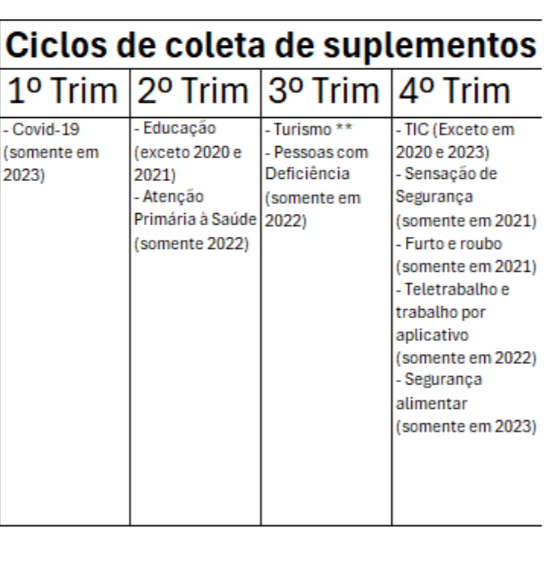{fig-align="center" width="100%" height="100%"}
:::
:::::

## [Formas de importação dos dados]{.theme-subtopic} {.smaller}

::::: columns
::: {.column width="70%"}
**4. Importação dos dados ACUMULADOS em determinado trimestre para suplementos específicos:**

Variáveis iniciadas com $S$: ver sempre o dicionário

```{r,eval=FALSE}
 Pnad_2022_2s <- get_pnadc(
   year = 2022, # obrigatório de ser declarado
   topic = 4, # utilizado somente quando importaremos dados em determinado trimestre
   selected = TRUE, # utilizado para suplementos coletados para alguns moradores
   design = TRUE, # opcional, utilizado caso queira aplicar o plano amostral complexo aos dados
   vars = c("codigo_variavel1","codigo_variavel2", "codigo_variavelN"), # opcional
   labels = TRUE, # é o default, para rotular os dados
   deflator = TRUE # é o default, para incluir variável de deflacionamento direto do IBGE
)
```
:::

::: {.column width="30%"}
{fig-align="center" width="100%" height="100%"}
:::
:::::

## Vamos para o R! {.theme-next .smaller}

:::::: columns
::: {.column width="40%"}
Abram o arquivo: `dia 4 > praticas > codigos > Aula 4 - roteiro completo.R`
:::

:::: {.column width="60%"}
::: {style="display: flex; justify-content: flex-end; align-items: center; height: 100vh;"}
```{=html}

```
:::
::::
::::::

# Pausa! {.theme-stop}

::: {style="display: flex; justify-content: flex-end; align-items: center; height: 100vh;"}
```{=html}

```
:::

## [Sobre o caso]{.theme-subtopic} {.smaller}

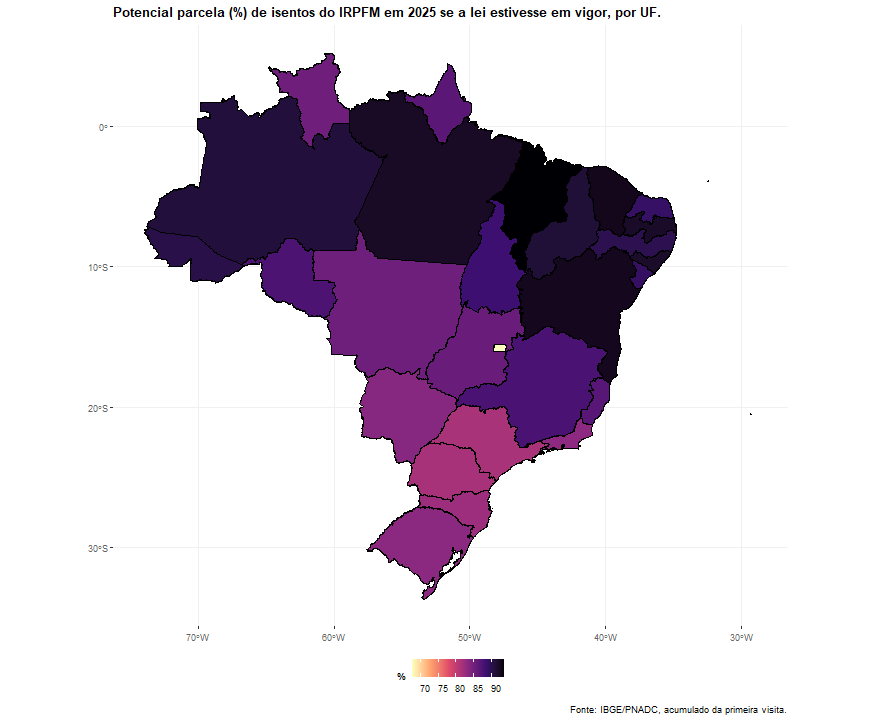{fig-align="center" width="70%" height="70%"}

# Tópico complementar {.theme-first}

::: {style="text-align: left;"}
Compatibilização da PNADc!
:::

## [Forças e fraquezas da PNADc]{.theme-subtopic} {.smaller}

Potencialidades

- **Representatividade amostral e frequência temporal de divulgação dos dados:** é a melhor base neste sentido no contexto brasileiro.

- **Captação de características do trabalho:** informalidade, subutilização da mão de obra, desalento, tempo de trabalho remunerado e não remunerado, trabalho doméstico, etc.

- **Tópicos emergentes com representativa das estimativas a nível nacional:** trabalho por aplicativo, Covid-19.

- **Evolução temporal:** acompanhamento de diferentes indicadores por uma longa série.

## [Forças e fraquezas da PNADc]{.theme-subtopic} {.smaller}

Limitações

- **Viés de quem responde:** é uma pesquisa que coleta informações de todos os corresidentes, *mas quem responde a todas elas é o entrevistado*.

- **Questionário e quesitos**: insuficiência de quesitos contidos no questionário básico e complementar/suplementar.

- **Tamanho da amostra**: Novos programas e políticas (ou até mesmo fenômenos) sociais que afetam a um público muito específico da população não será bem captado.

- Recortes geográficos

- Outros?

## [Compatibilização da PNADc]{.theme-subtopic} {.smaller}

::: nonincremental
O que estamos chamando por compatibização?

- Harmonização de conceitos e variáveis entre fontes

- Uso de uma mesma unidade de comparação entre fontes.
:::

## [Compatibilização da PNADc]{.theme-subtopic} {.smaller}

::: nonincremental
O que estamos chamando por compatibização?

- Harmonização de conceitos e variáveis entre fontes

- Uso de uma mesma unidade de comparação entre fontes.

Por que compatibilizar?

- Para endereçar uma das limitações e/ou potencialidades endereçadas anteriormente.
:::

## [Compatibilização da PNADc]{.theme-subtopic} {.smaller}

::: nonincremental
O que estamos chamando por compatibização?

- Harmonização de conceitos e variáveis entre fontes

- Uso de uma mesma unidade de comparação entre fontes.

Por que compatibilizar?

- Para endereçar uma das limitações e/ou potencialidades endereçadas anteriormente.

Como compatibilizar?

- **Pressuposto:** Estamos trabalhando com indivíduos distintos.

- **Estratégias:** Buscar unidades de análise em comum. Ex.: classes sociais (EGP, etc.), unidades geográficas, mesmo indicador, ...
:::

# Tópico complementar {.theme-first}

::: {style="text-align: left;"}
4 Exemplos de compatibilização!
:::

## [Exemplos de compatibilização da PNADc]{.theme-subtopic} {.smaller}

:::::: columns
::: {.column width="70%"}
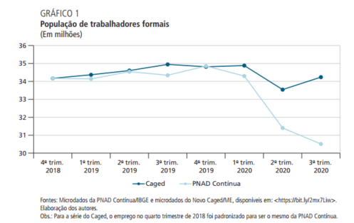{fig-align="center" width="100%" height="100%"}
:::

:::: {.column width="30%"}
::: nonincremental
**Exemplo 1**: Avaliação da qualidade dos dados **da PNADc**[^ex1]:

- Assume-se o Caged, registro administrativo, como fonte de referência.
:::
::::
::::::

[^ex1]: [Corseil e colegas (2022)](http://dx.doi.org/10.38116/978-65-5635-042-4/capitulo27).

## [Exemplos de compatibilização da PNADc]{.theme-subtopic} {.smaller}

:::::: columns
::: {.column width="70%"}
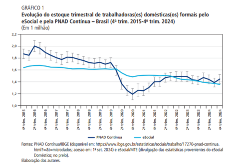{fig-align="center" width="100%" height="100%"}
:::

:::: {.column width="30%"}
::: nonincremental
**Exemplo 2**: Avaliação da qualidade dos dados **de registro administrativo**[^ex2]:

- Assume-se a PNADc como a fonte de referência para as estimativas.

- Utilizada quando se pretende avaliar novas fontes de dados.
:::
::::
::::::

[^ex2]: [Almeida e colegas (2025)](https://repositorio.ipea.gov.br/handle/11058/17266).

## [Exemplos de compatibilização da PNADc]{.theme-subtopic} {.smaller}

:::::: columns
::: {.column width="70%"}
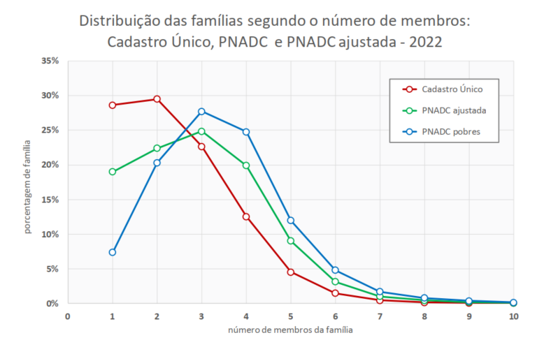{fig-align="center" width="100%" height="100%"}
:::

:::: {.column width="30%"}
::: nonincremental
**Exemplo 3**: Proposição de uma nova unidade de análise não contida na PNADc[^ex3]:

- Assume-se que a representatividade populacional de ambas as bases são semelhantes.
:::
::::
::::::

[^ex3]: [Insper (2024)](https://repositorio.insper.edu.br/handle/11224/6478).

## [Exemplos de compatibilização da PNADc]{.theme-subtopic} {.smaller}

:::::: columns
::: {.column width="70%"}
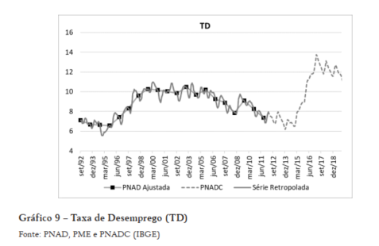{fig-align="center" width="100%" height="100%"}
:::

:::: {.column width="30%"}
::: nonincremental
**Exemplo 4**: Comparação da PNADc com indicadores de trabalho e renda em períodos não cobertos[^ex4]:

- Assume-se que embora os níveis não sejam semelhantes, a tendência deveria ser parecida.
:::
::::
::::::

[^ex4]: [Vaz e Barreira (2022)](https://dx.doi.org/10.1590/1980-53575145botc).

# Próximos passos {.theme-first}

::: {style="text-align: left;"}
:::

## [Recapitulando]{.theme-subtopic} {.smaller}

::: nonincremental
O que vimos no curso:

- Finalidades da PNADC

- Mudanças entre PNAD e PNADC e as vantagens da nova pesquisa

- SIPD e construção da Amostra Mestra

- Operacionalização da coleta da PNADC

- Estratégias de divulgação da pesquisa

- R e RStudio para análise de dados

- Técnicas de avaliação da qualidade das estimativas

- Formas de importação de dados da PNADC em R

- Manipulações e análises da PNADC orientada a problemas empíricos

- Tópico complementar!
:::

## [Na PNADC]{.theme-subtopic} {.font-size-small}

::: nonincremental
- Limitações de análises

  - Pandemia de Covid-19 e qualidade das estimativas

- Diferentes estimativas para diferentes pesos adotados

- Compatibilização com outras bases de dados públicas ou privadas

- Análises em nível micro (geograficamente)

- Compatibilização da série PNAD (antiga) e PNADC

- Longitudinalização da PNADC

- O que o Censo 2022 traz de novidade?

- Tópicos complementares de análise

  - Classificações de atividade econômica e ocupação (CNAE e CBO)

  - Ponderação manual dos dados da PNADC após manipulação ([exemplo](https://github.com/thiagocalm/Idoso_raca_mt))

  - Trabalhando com deflacionamentos na PNADC

  - Trabalhando com análises a nível domiciliar com PNADC

- ...
:::

## [No R]{.theme-subtopic} {.smaller}

::: nonincremental
- Gramática Tydiverse para manipulação de dados

- Gráficos em `{ggplot}`

- Criando suas próprias funções em R

- Mapas em R

- Automatização e reprodutibilidade de processos

- ...
:::

## [Outros cursos do cebrap.lab]{.theme-subtopic}

::: nonincremental
- Toda a trilha quanti! :)

- Análise quantitativa de texto com R - Ao fim desse mês
:::

## Isso é tudo para hoje! {.theme-next}

## Isso é tudo para hoje! {.theme-next}

::: nonincremental
Exercício final!

- Arquivo: `dia 5 > Exercício final.pdf`

- Relatório *simples* explorando como um determinado fenômeno de interesse pode ser estudado com a PNADC.

  - Foque aqui em descrever qual tipo de dado da PNADC seria adequado e o motivo, potencialidades e limitações.

- Prazo de envio: 30/11.
:::

#  {.cebrap-fim .smaller}

{.absolute top="-90" right="460" width="100" height="100"}

:::::: columns
:::: {.column width="50%"}
::: {style="text-align: right;"}
**Presidência**

**Diretoria Administrativa**

**Diretoria Científica**

**Coordenação de Seminários**

**Coordenação de Cursos**
:::
::::

::: {.column width="50%"}
Adrian Gurza Lavalle

Victor Callil

Arilson Favareto

Bianca Tavolari

Monise Fernandes Picanço
:::
::::::

::: {style="text-align: center;"}
**Curso**

Pesquisa Nacional por Amostra de Domicílios Contínua (PNADC)

**Ministrante**

Thiago Cordeiro Almeida

E-mail: [thiagocordalmeida\@gmail.com](thiagocordalmeida@gmail.com)

Github: [\@thiagocalm](github.com/thiagocalm)
:::
